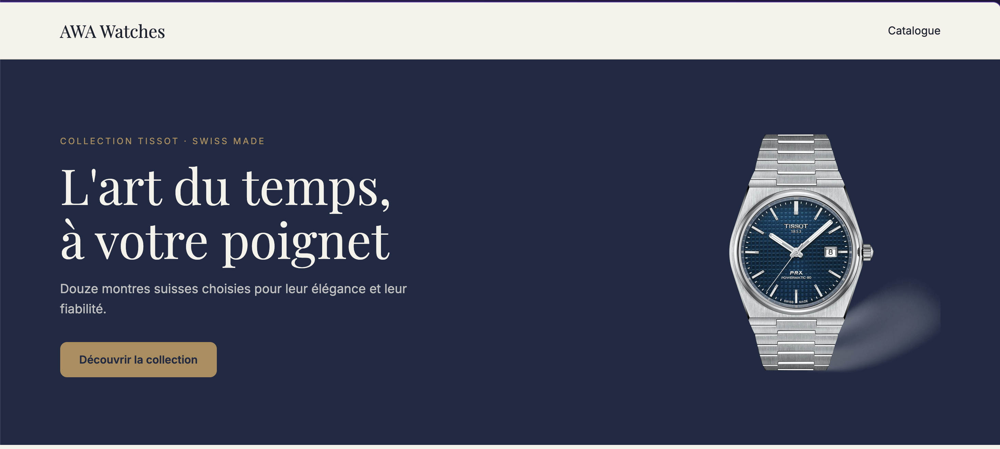
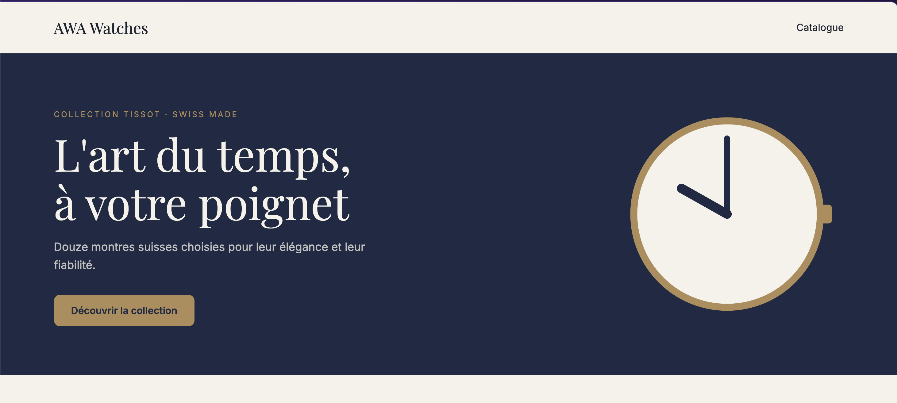

# Changelog

## Week 2 — CSS animations
- Serve the Tissot watch dataset from the Express API
- Display the watches in a responsive grid
- Highlight cards on hover and keyboard focus (transition)
- Animate the title on page load (@keyframes)
- Respect prefers-reduced-motion

## Week 3 — SVG
- Add hero and type filters
- Replace hero photo with an inline SVG watch component
- Rotate the minute hand on hover and keyboard focus
- Split styles into base, layout and animations
- Play the watch hand animation once on load
- Disable the watch hand animation with reduced motion
| Before | After |
|---|---|
|  |  |